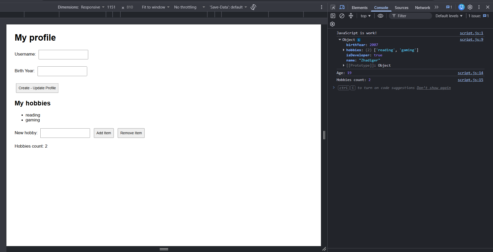
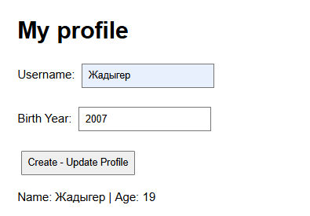
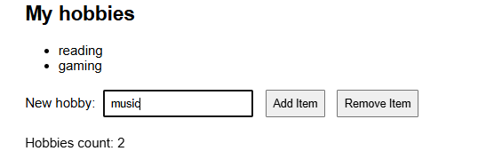

# Assignment 5 JavaScript Basics

**Name:** Zhadiger Saken
**Group:** SE-2538

## Part 1 Profile Object, Data Types and Arithmetic

### Task 1 Personal Info Object
I created a userProfile object with name, birthYear,
isDeveloper and hobbies.

### Task 2 Arithmetic Calculations
The program calculates age using the current year
and counts the hobbies.

## Part 2 Form Input and Events

### Task 3 HTML Form
The form contains username and birth year inputs
and a Create - Update Profile button.

### Task 4 Event Listener
Submitting the form updates userProfile and displays
the name and recalculated age on the page.

## Part 3 DOM List Manipulation

### Task 5 Creating and Removing Elements
The page displays hobbies in an unordered list.
Add Item adds a new hobby.
Remove Item removes the last hobby.

## Work Process

First, I created the HTML page and connected the JavaScript file. Then I added the userProfile object, age calculation, profile form and hobbies list. I used the browser console to check the data and tested updating the profile, adding hobbies and removing the last hobby. Finally, I added simple CSS styles to make the page easier to read.
